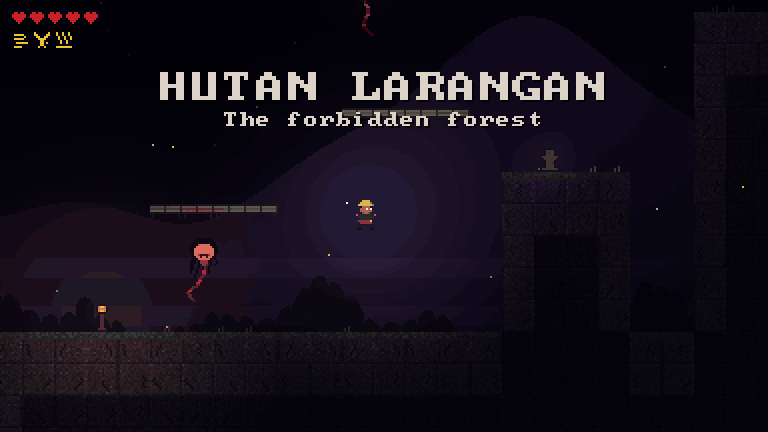
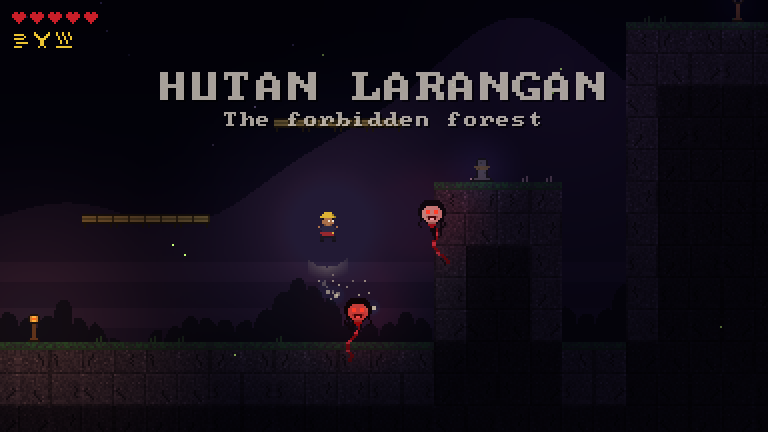
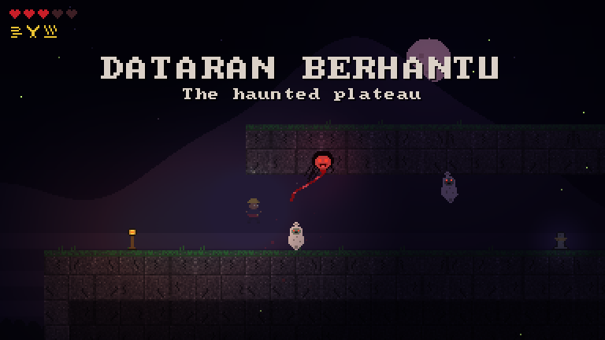

# Gunung Ledang

[](https://github.com/amirizalrahmat0799/gunung-ledang/actions/workflows/ci.yml)


[](LICENSE)

**A horror Metroidvania set on Malaysia's legendary mountain, written from scratch in C++20.**



The Sultan of Melaka asked for the hand of the Puteri of Gunung Ledang. She asked for a bridge of gold, a bridge
of silver, seven trays of mosquito hearts and a bowl of his son's blood. He refused the last, and she vanished
into the mountain. Climb it: past the bamboo-stake ravine, through the forbidden forest and up the waterfall
shaft to her shrine at the summit, while the penanggal and pocong come for you in the dark.

## The game

- **Movement built for precision:** coyote time, jump buffering, variable jump height, and three abilities from
  the mountain's keramat (shrines): **Dash**, **Double Jump** and **Wall Jump**. Each one opens the next part of
  the climb.
- **Keris combat in three directions:** strike sideways, upward, or downward in the air. A downward strike
  **bounces** you off spirits and off the bamboo stakes, and gives back your double jump and air dash.
- **Spirits from Malay folklore:** the **penanggal**, a flying head trailing its entrails, and the **pocong**, a
  shrouded corpse that can only hop toward you.
- **Hits that feel heavy:** hit-stop, white hit-flash, screen shake, recoil, squash and stretch, dust and sparks.
- **Lanterns** heal you, become your respawn point, and save the game. Touching the stakes puts you back on the
  last safe ground, as in Hollow Knight.
- **Darkness:** a lightmap leaves only lantern light, your torch and the spirits' glow visible.
- **All art is generated in code:** sprites from ASCII pixel art, tiles from seeded noise. No image files.

## Screenshots

| | |
|---|---|
|  |  |
|  |  |

## Download

Grab the newest build from [Releases](https://github.com/amirizalrahmat0799/gunung-ledang/releases): a zip for
Windows (a single `gunung_ledang.exe`, nothing to install) and a tarball for Linux. Windows may say "Windows
protected your PC" because the game isn't code-signed: click **More info**, then **Run anyway**.

## Controls

| Action | Keyboard | Gamepad |
|---|---|---|
| Move | A / D or arrows | Left stick or d-pad |
| Jump (hold for height) | Space, Z or K | A |
| Strike with the keris | J or X | X |
| Strike up | Hold W or up, strike | Up + X |
| Strike down (in the air) | Hold S or down, strike | Down + X |
| Dash *(Keramat Angin)* | Shift, C or L | B or RB |
| Drop through bamboo platforms | S or down | Down |
| Pause | Esc | Start |

Your progress is saved at every lantern and shrine and when you quit: on Windows in
`%APPDATA%\Amirizal\GunungLedang\save.txt`.

## Build and run

### Windows, Visual Studio 2022

Open the folder in Visual Studio (**File > Open > Folder**), pick the `x64 Release` preset, and press **F5**.
SDL3 is downloaded and built automatically the first time and linked into the exe, along with the C++ runtime,
so `gunung_ledang.exe` runs on its own on any Windows PC.

Or from a Developer Command Prompt:

```bat
cmake -S . -B build -G "Visual Studio 17 2022" -A x64
cmake --build build --config Release
build\Release\gunung_ledang.exe
```

### Linux and macOS

```bash
cmake -S . -B build -DCMAKE_BUILD_TYPE=Release
cmake --build build -j
./build/gunung_ledang
```

If SDL3 is already installed it is used; otherwise it is fetched.

### Development options

| Option | What it does |
|---|---|
| `--warp N` | Start at lantern N (0 summit, 1 plateau, 2 village, 3 forest) with every ability. Never touches your save |
| `--start` | Skip the title screen |
| `--debug` | Overlay with FPS, tick, position and velocity (also F1) |
| `--save file` | Use a different save file |
| `--autoplay --screenshot shot.bmp --seconds 3` | A scripted player; saves a frame and quits (used by CI) |
| `--autoplay --record dir --frames 150` | Saves 150 frames at a steady 30 fps as BMPs, for making GIFs like the one above |

## How it's built

```
fixed 60 Hz simulation                          rendering (any refresh rate)
----------------------                          ----------------------------
input -> World::update(buttons)                 draw the world between the last two ticks
  player movement, strikes, pogo                  (interpolated, so 144 Hz looks smooth)
  stakes, shrines, lanterns, summit             lightmap: darkness, then lights added on top
  spirits: AI and contact damage                glow pass: eyes, slashes, sparks over the dark
  -> events (hit, kill, pogo, hurt, ...)  --->  hit-stop, shake, particles, banners, saving
```

- **Deterministic simulation.** Positions and velocities are integers in 1/256 pixel units, so the same inputs
  always produce exactly the same world, on any compiler or CPU. A test runs 6000 ticks of random input through
  two worlds and requires them to stay identical, spirits included. It makes replays possible, and keeps the
  door open for co-op.
- **The simulation knows nothing about graphics.** It reports what happened as events, and the game turns those
  into feel: hit-stop freezes the world for a few ticks (3 for a hit, 6 for a kill, 9 when you are hurt), while
  the camera, particles and flashes keep moving.
- **Saves** are plain text with a checksum, written to a temporary file and renamed into place, so a crash or a
  hand-edited file can't leave you with a half-loaded game.

### The co-op edition

[v0.1.0](https://github.com/amirizalrahmat0799/gunung-ledang/releases/tag/v0.1.0) was a four-player online co-op
version with Source-engine-style netcode written from scratch: client-side prediction with server
reconciliation, entity interpolation, lag compensation, delta-compressed snapshots and reliable messages over
UDP, tested by bots playing for two minutes on a 150 ms, 5% loss network. Its code and the write-up of how it
works ([docs/netcode.md](https://github.com/amirizalrahmat0799/gunung-ledang/blob/v0.1.0/docs/netcode.md)) are
in that tag.

## Tests

```bash
ctest --test-dir build --output-on-failure              # Linux / macOS
ctest --test-dir build -C Release --output-on-failure   # Visual Studio
```

- **Determinism:** random inputs replayed from a midpoint give a bit-identical player; two whole worlds stay
  identical for 6000 ticks.
- **Level design checks:** the ravine is wider than a running jump (5.5 tiles) but not a dash jump (10.8); the
  plateau is higher than a jump (3.3 tiles) but not a double jump (5.9); the shaft can only be climbed with wall
  jumps.
- **Combat:** strikes reach in three directions; a scripted player crosses a 14-tile stake pit by bouncing on it
  without being hurt; spirits hunt the player and can be cut down.
- **Hazards and checkpoints:** stakes put you back on safe ground; dying returns you to your lantern; lanterns
  heal.
- **Saves:** round trips, and truncated, corrupted or edited files are rejected; restoring puts you at your lantern.

## Releasing

Push a version tag and GitHub Actions builds Windows and Linux packages, runs every test, and publishes them as a
GitHub Release with checksums ([release.yml](.github/workflows/release.yml)):

```bash
git tag v0.2.0
git push origin v0.2.0
```

## Project layout

```
src/core     clock, command-line options
src/sim      map, player movement and strikes, spirits, world rules, save format
src/client   the game: main loop, hit-stop and effects, menus and HUD, renderer, generated sprites
tests        simulation and save tests
packaging    the README shipped with releases, Windows version info
```

## Roadmap

- [ ] The summit guardian: the Puteri's spirit as a boss fight
- [ ] Sound: gamelan and wind, the penanggal's cries
- [ ] A map screen and more areas
- [ ] Hand-drawn art to replace the generated placeholders
- [ ] Steam: achievements and cloud saves

## License

[Apache License 2.0](LICENSE) © Ahmad Amirizal Rahmat. The legend of Puteri Gunung Ledang is Malay folklore;
all code and art in this repository are original.
