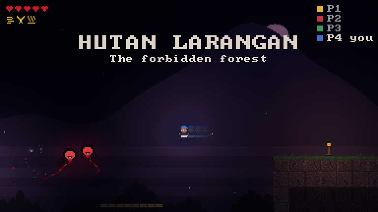
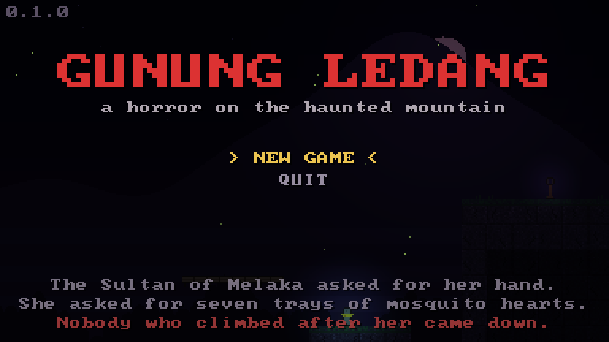
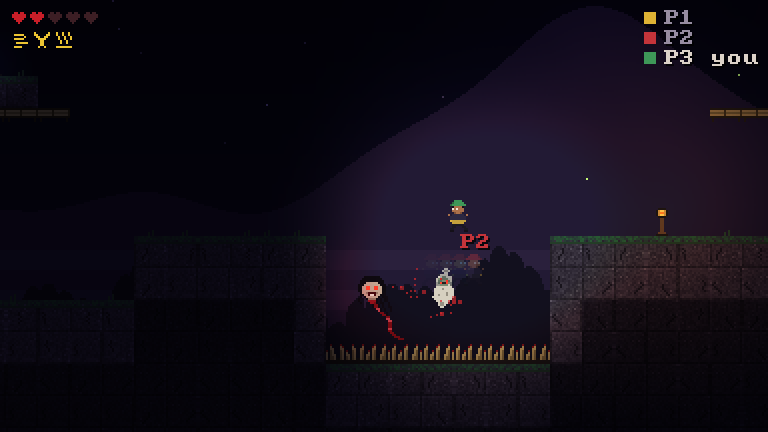
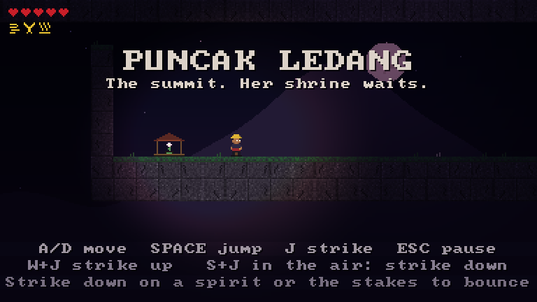
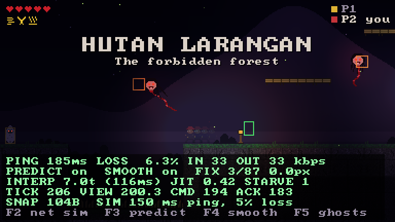

# Gunung Ledang

[](https://github.com/amirizalrahmat0799/gunung-ledang/actions/workflows/ci.yml)


[](LICENSE)

**A co-op horror Metroidvania for up to four players, set on Malaysia's legendary mountain, with
Source-engine-style multiplayer netcode written from scratch in C++20.**



The Sultan of Melaka asked for the hand of the Puteri of Gunung Ledang. She asked for a bridge of gold, a bridge
of silver, seven trays of mosquito hearts and a bowl of his son's blood. He refused the last, and she vanished
into the mountain. Climb it with your friends: past the bamboo-stake ravine, through the forbidden forest and up
the waterfall shaft to her shrine at the summit, while the penanggal and pocong come for you in the dark.

## Why this project

It is a small game built to show the hard part of online games: making a fast, physics-heavy platformer feel
instant for everyone on a 150 ms connection with packet loss, while the server stays authoritative.

- **Client-side prediction** with server reconciliation: your character moves the moment you press a key.
- **Entity interpolation** with an adaptive delay: other players and spirits glide smoothly from 30 Hz snapshots.
- **Lag compensation**: the server rewinds the spirits to what you saw when you swung your keris.
- **Delta-compressed, bit-packed snapshots** against the last snapshot each client acknowledged.
- **Reliable messages over UDP**: acks, ack bitfields, RTT and loss estimates, in-order delivery.
- **A fixed-point deterministic simulation**, shared by client and server, so replays are bit-exact.
- **A soak test** that plays three bots for two minutes on a 150 ms, 5% loss network and checks that nothing broke.

Every piece is written here: no networking library, no engine. SDL3 is only used for the window, input and
drawing, and all art is generated in code.

## Screenshots

| | |
|---|---|
|  |  |
|  |  |

The last one has the network overlay (F1) and ghost boxes (F5) on, with 150 ms of simulated lag. The green box
is where the server last said you were: you are drawn *ahead* of it, because your client predicts the inputs the
server hasn't seen yet. The orange boxes are where the server last said the spirits were: they are drawn
*behind* them, because the client interpolates between snapshots it has already received.

## Build and run

### Windows, Visual Studio 2022

Open the folder in Visual Studio (**File > Open > Folder**), pick the `x64 Release` preset, and press **F5**.
SDL3 is downloaded and built automatically the first time; `gunung_ledang` is the startup project.

Or from a Developer Command Prompt:

```bat
cmake -S . -B build -G "Visual Studio 17 2022" -A x64
cmake --build build --config Release
build\Release\gunung_ledang.exe
```

### Linux and macOS

```bash
cmake -S . -B build -DCMAKE_BUILD_TYPE=Release
cmake --build build -j
./build/gunung_ledang
```

If SDL3 is already installed (`find_package(SDL3)` succeeds), it is used; otherwise it is fetched.
`-DLEDANG_BUILD_CLIENT=OFF` builds only the server, bot and tests, with no dependencies at all.

### Playing together

| | |
|---|---|
| **Host** | Start the game and press **1**. Others join your IP on UDP port 27015. |
| **Join** | Press **2** and type the host's address, or run `gunung_ledang --connect 192.168.1.20` |
| **Dedicated server** | `ledang_server --port 27015` |
| **Fill the party with bots** | `gunung_ledang --host --bots 3`, or `ledang_bot --connect host --bots 3` against any server |

### Controls

| Action | Keyboard | Gamepad |
|---|---|---|
| Move | A / D or arrows | Left stick or d-pad |
| Jump (hold for height) | Space, Z or K | A |
| Attack with the keris | J or X | X |
| Dash *(Keramat Angin)* | Shift, C or L | B or RB |
| Drop through bamboo platforms | S or down | Down |

Abilities come from three keramat (shrines) and are shared by the whole party: **Dash** gets you over the
ravine, **Double Jump** onto the haunted plateau, **Wall Jump** up the waterfall. Touch a lantern to light it:
it heals you and becomes your respawn point.

### Netcode demo keys

| Key | |
|---|---|
| F1 | Network overlay: ping, loss, bandwidth, prediction corrections, interpolation delay, ticks |
| F2 | Simulate a bad network: off, 50 ms / 1%, 150 ms / 5%, 250 ms / 10% |
| F3 | Prediction on/off. Off, you feel the full round trip on every input |
| F4 | Smoothing of prediction errors on/off. Off, corrections snap |
| F5 | Ghost boxes: the server's newest positions next to what is drawn |

Try F2 twice, then F3: the difference between a predicted and an unpredicted 150 ms game is the whole point.

## How the netcode works

The full walkthrough, with the reasons behind each choice, is in [docs/netcode.md](docs/netcode.md). In short:

```
client (60 Hz)                                   server (60 Hz, authoritative)
--------------                                   -----------------------------
sample input -> UserCmd #n {buttons, view_tick}
predict own player: step_player(cmd)
send the newest 8 cmds every tick  ---------->   queue cmds in order, drop duplicates
                                                 run <= 4 per tick, ~1 per tick on average (speed-hack guard)
                                                 attack? rewind spirits to cmd.view_tick, then test the blade
                                                 step spirits, contact damage, shrines, lanterns
                                   <----------   every 2 ticks: snapshot delta vs the client's last ack
on snapshot: reset own player to server state,                + reliable events (pickups, deaths)
  replay cmds after last_cmd, smooth the error
draw others at (newest tick - ~7 ticks),
  interpolating between two snapshots
```

| | |
|---|---|
| Tick rate | 60 Hz simulation, 30 Hz snapshots |
| Simulation | Integer fixed point (1/256 px), identical on client and server |
| Upstream | Last 8 commands in every packet: at 5% loss an input is lost only if 8 packets in a row are (0.05^8) |
| Snapshots | Per-field change bits plus zigzag varints, delta against the newest acked snapshot. About 90 bytes for the world, 3 to 4 players and 8 spirits (165 bytes in full) |
| Bandwidth | About 30 kbps down, 34 kbps up per player, packet headers included |
| Interpolation delay | 4 ticks + 2.5 x measured jitter (+2 ticks when losing packets), changed by at most 2 ticks per second |
| Lag compensation | 128 ticks of history, clamped to 30 ticks (500 ms) back |
| Packets | 1200 bytes max. Handshake with salts; connect requests are padded so the server never amplifies |

## Tests

```bash
ctest --test-dir build --output-on-failure        # Linux / macOS
ctest --test-dir build -C Release --output-on-failure   # Visual Studio
```

- **Bit packing and sequence numbers**: round trips, varint sizes, overruns, and fuzzing with random data.
- **Reliability**: 500 reliable messages over a link that drops 20%, duplicates and reorders. All arrive, in order, once.
- **Determinism**: 3000 random inputs replayed from a midpoint give a bit-identical player; the player never ends up inside a wall.
- **Level design checks**: the ravine is wider than a running jump (5.5 tiles) but not a dash jump (10.8); the
  plateau is higher than a jump (3.3 tiles) but not a double jump (5.9); the shaft can only be climbed with wall jumps.
- **Lag compensation**: at the moments when a laggy client's swing should land but a present-time check would
  miss, the rewound check hits; requests older than 500 ms are clamped.
- **Snapshots**: delta and full encodings decode to the same state; corrupted packets are rejected without crashing.
- **End to end**: real UDP sockets on loopback, a server and clients in fast virtual time: handshake, server
  full, disconnects, and prediction converging exactly on the server's state.
- **Soak**: three bots, two minutes, 150 ms round trip with ±20 ms jitter and 5% loss each way. Asserts no decode
  errors, no missing delta baselines, no lost inputs, bandwidth under 64 kbps, and a converged prediction.

Sample soak output:

```
server: 7200 ticks, 21526 cmds run, 0 gaps, 0 dropped, avg snapshot 92 bytes, 100% delta
client 1: rtt 175 ms, loss 6.3%, in 30.0 kbps, out 34.4 kbps, corrections 44/3365, interp 8.2 ticks
```

## Project layout

```
src/core     bit packing, sequence numbers, clock
src/net      UDP socket, link conditioner (fake lag/loss), reliable connection
src/sim      fixed-point map, player movement, spirits, world rules, lag-compensation history
src/proto    commands, snapshots and their delta encoding, events, handshake packets
src/server   the authoritative server (also runs inside the game when you host)
src/client   client core (prediction, interpolation) and the SDL3 game: sprites, lighting, HUD
src/bot      headless bot players for load and soak testing
tests        unit, end-to-end and soak tests
```

## Roadmap

- [ ] The summit guardian: the Puteri's spirit as a boss fight
- [ ] Sound: gamelan and wind, positional cries from the penanggal
- [ ] Steamworks: lobbies, invites and Steam Datagram Relay as a transport behind `UdpSocket`
- [ ] Client-side prediction of hits (blood on your own swing before the server confirms)
- [ ] Demo recording and playback from the command stream

## License

[Apache License 2.0](LICENSE) © Ahmad Amirizal Rahmat. The legend of Puteri Gunung Ledang is Malay folklore;
all code and art in this repository are original.
